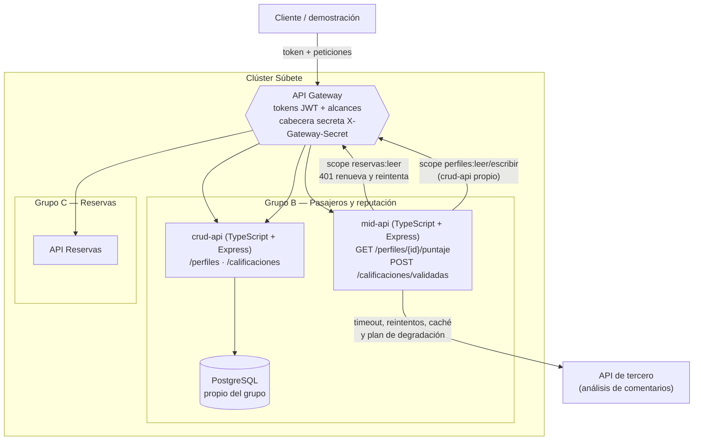

# Subete-ServicePyC-TSNode — Grupo B: Pasajeros y reputación

Repositorio del **Grupo B — Pasajeros y reputación** del clúster **Súbete** (viajes compartidos en carro entre estudiantes), para el proyecto final de la Electiva de Desarrollo Web Backend.

Este repositorio contiene **dos servicios independientes**:

| Servicio | Tipo | Responsabilidad |
| --- | --- | --- |
| `services/crud-api` | API CRUD | Perfiles y calificaciones, con su PostgreSQL propio |
| `services/mid-api` | API MID | Puntaje de confianza e insignias; calificaciones validadas contra Reservas |

> **Estado:** esqueleto de proyecto. La estructura, el middleware (cabecera del gateway, formato de error común), `app.ts`/`server.ts`, las migraciones y los contratos OpenAPI están listos; las funciones de negocio están marcadas con `// TODO` y responden `501 no_implementado` para que cada integrante implemente su parte.

---

## Índice

1. [Arquitectura utilizada y por qué](#1-arquitectura-utilizada-y-por-qué)
2. [Qué va en cada parte](#2-qué-va-en-cada-parte)
3. [Descripción de las APIs](#3-descripción-de-las-apis)
4. [Lenguaje y framework](#4-lenguaje-y-framework)
5. [Dependencias](#5-dependencias)
6. [Variables de entorno](#6-variables-de-entorno)
7. [Cómo ejecutar localmente](#7-cómo-ejecutar-localmente)
8. [Cómo correr las pruebas](#8-cómo-correr-las-pruebas)
9. [Flujo del pipeline (GitHub Actions)](#9-flujo-del-pipeline-github-actions)
10. [Integración con el clúster Súbete](#10-integración-con-el-clúster-súbete)
11. [Ficha del API de tercero](#11-ficha-del-api-de-tercero)
12. [Integrantes](#12Integrantes)

---

## 1. Arquitectura utilizada y por qué

Construimos **dos microservicios separados** (`crud-api` y `mid-api`) en lugar de un monolito o un solo despliegue acoplado, porque:

- **Aíslan responsabilidades:** el CRUD es dueño de los datos (perfiles y calificaciones en PostgreSQL); el MID no es dueño de datos básicos: aplica reglas de negocio combinando llamadas a otros servicios.
- **Aíslan dependencias:** el CRUD solo necesita `express` y `pg`; el MID necesita clientes HTTP resilientes, tokens y un cliente del API de tercero. Una vulnerabilidad o actualización en uno no afecta al otro.
- **Aíslan ciclos de despliegue y escalado:** cada servicio tiene su propia imagen Docker, su propia URL estable y su propio ciclo de publicación. Si solo cambian las reglas de reputación, se redespliega únicamente el MID.
- **Permite fallos controlados:** si el MID se cae, el CRUD sigue sirviendo perfiles (y viceversa); el MID degrada según su plan de degradación.

Nos integramos con el resto del clúster Súbete mediante **contratos OpenAPI** y un **API Gateway** que:

1. emite y valida **tokens JWT** con flujo **Client Credentials** y **alcances** (`perfiles:leer`, `reservas:leer`, …);
2. enruta según los contratos;
3. agrega una **cabecera secreta** (`X-Gateway-Secret`) a cada petición reenviada — **nuestros servicios la exigen y rechazan con 401 cualquier llamada directa**, para que nadie use el servicio saltándose el gateway.



Reglas transversales que cumplen ambos servicios:

- **Formato de error común** del clúster en todas las respuestas de error: `{ "codigo": "...", "mensaje": "...", "detalle": {} }`.
- **`GET /health` responde `200`** en ambos servicios (exento de la cabecera del gateway para la prueba de humo).
- **Ningún servicio lee la base de datos de otro**: el MID consume al CRUD por API, nunca por SQL.
- **Nada hardcodeado**: URLs, credenciales y parámetros viven en variables de entorno (ver [`.env.example`](.env.example), sin secretos reales).

---

## 2. Qué va en cada parte

```text
Subete-ServicePyC-TSNode/
├── .github/
│   └── workflows/
│       ├── ci.yml                  # PR abierto/actualizado: typecheck, pruebas, linter OpenAPI, build Docker
│       └── deploy.yml              # PR fusionado a main: publica imagen, despliega y prueba /health
├── services/
│   ├── crud-api/                   # Servicio CRUD: perfiles y calificaciones + PostgreSQL
│   │   ├── docs/openapi/           # Contrato OpenAPI de la API CRUD (lo revisa el clúster por PR)
│   │   ├── src/
│   │   │   ├── config/             # env.ts: carga y valida variables de entorno (falla al arrancar si faltan)
│   │   │   ├── middleware/         # Cabecera del gateway (401) y manejador del error común
│   │   │   ├── modules/
│   │   │   │   ├── perfiles/       # schemas (validación) → service (SQL) → controller → routes
│   │   │   │   └── calificaciones/ # ídem, con reglas 400/409 de calificación
│   │   │   ├── db/                 # pool de PostgreSQL, migrador y migraciones (.sql con esquema y semilla)
│   │   │   ├── app.ts              # arma Express: /health → cabecera → rutas → 404 → errores
│   │   │   └── server.ts           # arranca, verifica la BD y apaga ordenadamente
│   │   ├── tests/                  # pruebas unitarias y de API (sin necesidad de base de datos)
│   │   ├── Dockerfile              # imagen multi-stage (builder + runner sin devDependencies)
│   │   ├── package.json            # scripts: dev, build, typecheck, test, db:migrar, lint:openapi
│   │   ├── tsconfig.json           # typecheck de src + tests
│   │   └── tsconfig.build.json     # compilación de producción (solo src → dist)
│   └── mid-api/                    # Servicio MID: puntaje de confianza y calificaciones validadas
│       ├── docs/openapi/           # Contrato OpenAPI de la API MID (incluye plan de degradación)
│       ├── src/
│       │   ├── config/             # env.ts: gateway, URLs de vecinos, alcances, HTTP y tercero
│       │   ├── middleware/         # Igual que el CRUD (cada servicio es autónomo)
│       │   ├── clients/            # http.ts (timeout/reintentos), tokens.ts (401 → renueva y reintenta),
│       │   │                       # reservas.client.ts, crud.client.ts, tercero.client.ts (caché + degradación)
│       │   ├── modules/
│       │   │   ├── comunes/        # validaciones compartidas de cuerpos y parámetros
│       │   │   ├── puntaje/        # reputacion.ts (reglas puras) + servicio, controller y rutas
│       │   │   └── calificaciones-validadas/  # reglas de P-HU4
│       │   ├── app.ts
│       │   └── server.ts
│       ├── tests/                  # reglas del MID, mocks de Reservas/CRUD/tercero, token 401
│       ├── Dockerfile
│       └── package.json
├── .env.example                    # Plantilla de variables de entorno (sin secretos reales)
├── spectral-ruleset.yaml           # Reglas del linter de OpenAPI usado por el pipeline
└── README.md                       # Este documento
```

**Frontera con el repositorio del clúster:** la configuración del gateway, los contratos oficiales (copia de los de aquí, modificados por PR aprobado por los consumidores) y el `GATEWAY.md` viven en el **repositorio del clúster**, no aquí. Este repositorio solo publica el código de nuestros dos servicios y sus contratos de referencia. El **diagrama de arquitectura** del clúster queda en el repositorio del clúster y debe enlazarse aquí cuando esté publicado _(pendiente: enlace)_.

---

## 3. Descripción de las APIs

### 3.1 `crud-api` — Perfiles y calificaciones (PostgreSQL)

| Método y ruta | Qué hace | Códigos |
| --- | --- | --- |
| `GET /health` | Prueba de humo | 200 |
| `GET /perfiles` | Lista con filtros `rol` y paginación (`pagina`, `porPagina`) | 200, 400, 401 |
| `POST /perfiles` | Crea perfil (id autogenerado `usr-…`) | 201, 400, 401, **409** `correo_ya_registrado` |
| `GET /perfiles/{id}` | Detalle | 200, 401, 404 |
| `PUT /perfiles/{id}` | Actualiza `nombre`, `correo`, `rol` | 200, 400, 401, 404, 409 |
| `DELETE /perfiles/{id}` | **Desactiva** (borrado lógico; conserva el histórico) | 204, 401, 404 |
| `GET /calificaciones` | Lista con filtros `paraPerfilId`, `dePerfilId` y paginación | 200, 400, 401 |
| `POST /calificaciones` | Crea calificación | 201, 400, 401, **409** `calificacion_duplicada` |

Reglas clave (historias P-HU1 y P-HU2):

- Tablas: `perfiles` (`id`, `nombre`, `correo` **único**, `rol` ∈ `pasajero|conductor|ambos`, `activo`, `creado_en`) y `calificaciones` (`id`, `reserva_id`, `de_perfil_id`, `para_perfil_id`, `estrellas` 1–5, `comentario`, `creado_en`; **única por `reserva_id` + `de_perfil_id`**).
- Estrellas fuera de 1–5 → `400`; **auto-calificación → `400 auto_calificacion`**; correo repetido → `409`; dos calificaciones de la misma reserva por el mismo autor → `409`.
- Migraciones y semilla (pendiente de implementar): **12 perfiles** (`usr-01` … `usr-12`, los mismos IDs que usan los demás grupos) y 30 calificaciones coherentes con el clúster que dejan al menos un usuario **`confiable`** (usr-01), uno **`nuevo`** (usr-02) y uno **`en_observacion`** (usr-03). Los archivos `001_crear_esquema.sql` y `002_datos_semilla.sql` están en esqueleto (solo con la especificación en comentarios).

### 3.2 `mid-api` — Puntaje de confianza y calificaciones validadas

| Método y ruta | Qué hace | Códigos |
| --- | --- | --- |
| `GET /health` | Prueba de humo | 200 |
| `GET /perfiles/{id}/puntaje` | Puntaje 0–5 + insignia de un perfil | 200, 401, 404, **503** |
| `POST /calificaciones/validadas` | Califica un viaje **real y completado** | 201, 400, 401, 403, 404, 409, 503 |

**Reglas de `GET /perfiles/{id}/puntaje` (P-HU3):**

1. Perfil inexistente → `404 perfil_no_encontrado`.
2. **Promedio ponderado** de estrellas: las calificaciones de los últimos **30 días pesan el doble**.
3. Consulta a **Reservas** (`GET /reservas?usuarioId&estado`, alcance `reservas:leer`) la **tasa de cancelación** (`canceladas / total`) y los **viajes completados**.
4. `puntaje = promedioPonderado − tasaCancelacion × 2`, limitado entre **0 y 5**.
5. Insignia: **`nuevo`** (< 5 viajes completados, manda sobre el puntaje) → **`confiable`** (puntaje ≥ 4.5 y tasa < 10%) → **`en_observacion`** (puntaje < 3.5 o tasa > 30%) → **`regular`** (el resto).
6. **Si Reservas no responde → `503`** (no se calcula un puntaje incompleto).

**Reglas de `POST /calificaciones/validadas` (P-HU4):** recibe `{ reservaId, deId, paraId, estrellas, comentario }` y, en orden: reserva inexistente → `404`; estado distinto de `completada` → `409 reserva_no_completada`; perfiles que no participaron → `403 no_participante`; si todo está bien, analiza el comentario con el API de tercero y **crea la calificación en el crud-api** → `201`.

**Consumo resiliente:** token Client Credentials cacheado con renovación proactiva; ante **401 renueva y reintenta una sola vez**; **403** no se reintenta (error de permisos); **404/409/400** se propagan como negocio; **503, timeouts y red caída** se reintentan con límite y se traducen al error común.

---

## 4. Lenguaje y framework

- **Lenguaje:** **TypeScript** (tipado estricto, `strict`, `noUncheckedIndexedAccess`).
- **Runtime:** **Node.js** ≥ 22 (probado con Node 24).
- **Framework web:** **Express 5**.

Dentro del clúster Súbete, **al menos un grupo debe usar un lenguaje y un framework distintos** a los demás (por ejemplo, Python + FastAPI o Java + Spring Boot). Nuestro grupo cumple su parte con **TypeScript + Express**; la diversidad total del clúster queda documentada en la tabla del repositorio del clúster. Justamente por eso todo se integra por **contratos OpenAPI**: el lenguaje con el que esté escrito cada servicio no importa.

---

## 5. Dependencias

### `services/crud-api`

| Paquete | Tipo | Qué hace |
| --- | --- | --- |
| `express` | dependencia | Framework web: rutas, middlewares y manejo de errores |
| `pg` | dependencia | Cliente de PostgreSQL: pool de conexiones y queries parametrizadas |
| `dotenv` | dependencia | Carga las variables de entorno desde `.env` (sin subirlas a git) |
| `typescript` | desarrollo | Compilador/typecheck (`tsc`) |
| `tsx` | desarrollo | Ejecuta y observa TypeScript en desarrollo y en las pruebas |
| `@types/express` | desarrollo | Tipos de Express |
| `@types/pg` | desarrollo | Tipos de `pg` |
| `@types/node` | desarrollo | Tipos de Node (`node:test`, `crypto`, `fetch`, …) |

### `services/mid-api`

| Paquete | Tipo | Qué hace |
| --- | --- | --- |
| `express` | dependencia | Framework web |
| `dotenv` | dependencia | Variables de entorno |
| `typescript` | desarrollo | Compilador/typecheck |
| `tsx` | desarrollo | Ejecución de TS en desarrollo y pruebas |
| `@types/express`, `@types/node` | desarrollo | Tipos |

El MID **no necesita un driver de base de datos**: solo consume APIs por HTTP. Las pruebas usan el runner de pruebas nativo de Node (`node:test` + `node:assert`) — sin dependencias extra — con **inyección de dependencias** para mockear Reservas, el CRUD y el API de tercero. El linter de OpenAPI (`@stoplight/spectral-cli`) lo descarga `npx` en el pipeline, sin fijarlo como dependencia.

---

## 6. Variables de entorno

Toda la configuración sale de variables de entorno: **no hay URLs ni secretos hardcodeados**. La plantilla completa —**sin secretos reales**— está en [`.env.example`](.env.example); cópiala a `.env` en la raíz (o dentro de cada servicio, que tiene prioridad) y rellénala.

| Variable | Servicio | Descripción |
| --- | --- | --- |
| `GATEWAY_SECRET` | ambos | Cabecera `X-Gateway-Secret` que exigen los servicios (rechazo de llamadas directas) |
| `CRUD_API_PORT` / `MID_API_PORT` | ambos | Puerto de cada servicio (3001 / 3002 por defecto) |
| `DATABASE_URL` | crud-api | Cadena de conexión a su PostgreSQL propio |
| `GATEWAY_URL` | mid-api | Dirección del API Gateway (única puerta de entrada) |
| `GATEWAY_CLIENT_ID` / `GATEWAY_CLIENT_SECRET` | mid-api | Credenciales Client Credentials (en GitHub Secrets/produción) |
| `RESERVAS_URL` / `CRUD_URL` | mid-api | Base de los consumos (por defecto el gateway; permiten apuntar a un mock) |
| `SCOPE_LEER`, `SCOPE_ESCRIBIR`, `SCOPE_RESERVAS` | mid-api | Alcances que el gateway valida en nuestro token |
| `HTTP_TIMEOUT_MS`, `HTTP_REINTENTOS`, `HTTP_ESPERA_BASE_MS` | mid-api | Tiempo máximo, reintentos limitados y backoff de los consumos |
| `TOKEN_MARGEN_VENCIMIENTO_S` | mid-api | Margen para renovar el token antes de vencer |
| `TERCERO_URL`, `TERCERO_API_KEY` | mid-api | URL y credencial del API de tercero |
| `TERCERO_TIMEOUT_MS`, `TERCERO_REINTENTOS`, `TERCERO_CACHE_TTL_S` | mid-api | Timeout, reintentos y caché del tercero |
| `TERCERO_PLAN_DEGRADACION` | mid-api | `valor_por_defecto` o `503` (plan declarado en el OpenAPI) |

En producción los valores se definen como **secretos y variables seguros** de la plataforma (GitHub Secrets y configuración del servicio en Azure), nunca en el repositorio.

---

## 7. Cómo ejecutar localmente

**Requisitos:** Node.js ≥ 22 y npm; PostgreSQL (solo para el `crud-api`); Docker (opcional).

```bash
# 1. Clonar y crear el archivo de entorno
cp .env.example .env          # Windows: copy .env.example .env
#    → rellena GATEWAY_SECRET y DATABASE_URL (nada de secretos reales en git)

# 2. crud-api
cd services/crud-api
npm ci
npm run db:migrar             # aplica las migraciones (esquema y semilla: pendientes de implementar)
npm run dev                   # http://localhost:3001

# 3. mid-api (otra terminal)
cd services/mid-api
npm ci
npm run dev                   # http://localhost:3002
```

**Verificar sin gateway** (la cabecera secreta la conoce el gateway; en local la repites tú):

```bash
curl http://localhost:3001/health
curl http://localhost:3001/perfiles                      # → 401 cabecera_gateway_invalida
curl -H "x-gateway-secret: <GATEWAY_SECRET>" "http://localhost:3001/perfiles?rol=conductor&pagina=1"
curl -H "x-gateway-secret: <GATEWAY_SECRET>" http://localhost:3002/perfiles/usr-01/puntaje
# Los endpoints de negocio aún no implementados responden 501 no_implementado en el formato común.
```

**Con Docker:**

```bash
docker build services/crud-api -t subete-crud-api
docker build services/mid-api  -t subete-mid-api
docker run --env-file .env -p 3001:3001 subete-crud-api
docker run --env-file .env -p 3002:3002 subete-mid-api
```

**Flujo completo de punta a punta** (puntaje con reservas reales, calificación validada) requiere el gateway del clúster desplegado y las APIs de los grupos A y C; se sigue el guion de la demostración del documento del clúster.

---

## 8. Cómo correr las pruebas

```bash
cd services/crud-api && npm test     # 5 pruebas (esqueleto)
cd services/mid-api  && npm test     # 4 pruebas (esqueleto)
```

Ambos pipelines las corren con `npm test` (runner nativo `node:test`, sin salir a internet).

**`crud-api`** — pruebas de la infraestructura del esqueleto:

- `api.test.ts`: `/health` sin cabecera, **401 sin cabecera secreta** (con formato común), ruta desconocida → 404 y **501 `no_implementado`** en los endpoints pendientes.

**`mid-api`** — pruebas de la infraestructura del esqueleto:

- `api.test.ts`: `/health`, **401 sin cabecera secreta**, ruta desconocida → 404 y **501 `no_implementado`** en los endpoints pendientes.

Al implementar cada parte se añaden sus pruebas con **mocks inyectados** (inyección de dependencias en `DependenciasPuntaje` / `DependenciasValidacion` y `fetchFn` en los clientes HTTP): nunca se toca la red ni la base de datos de otro servicio.

---

## 9. Flujo del pipeline (GitHub Actions)

**Todo el flujo se dispara exclusivamente por `pull_request` — ningún workflow usa el evento `push`.** La rama `main` está protegida: nadie hace push directo, todo entra por PR aprobado.

### Al abrir o actualizar un PR → [`ci.yml`](.github/workflows/ci.yml)

| Job | Qué corre |
| --- | --- |
| `pruebas-y-build` (matriz: cada servicio) | `npm ci` → `npm run typecheck` → `npm test` → `npm run build` |
| `linter-openapi` | Spectral sobre ambos contratos (`--fail-severity=error`) |
| `build-imagen` (matriz) | `docker build` de cada servicio (sin publicar) |

Si algo falla, **el PR no se puede fusionar**.

### Al fusionar el PR en `main` → [`deploy.yml`](.github/workflows/deploy.yml)

Se activa solo con `pull_request.closed` **y** `merged == true` contra `main`:

1. login en Azure y en el registro de imágenes (ACR);
2. **build y publicación** de la imagen etiquetada con el SHA del commit;
3. **despliegue** de la nueva revisión (Azure Container Apps) usando las variables y secretos del environment `produccion`;
4. **prueba de humo**: reintenta hasta 12 veces y exige `GET /health` → **200**; si falla, queda registrado y se corrige con un nuevo PR.

**Secretos y variables requeridos** (en el environment `produccion`, jamás en el repo):

| Nombre | Tipo | Para qué |
| --- | --- | --- |
| `AZURE_CREDENTIALS` | secreto | Login de `azure/login` con un service principal |
| `ACR_LOGIN_SERVER` | variable | Dirección del registro de imágenes |
| `AZURE_RESOURCE_GROUP` | variable | Grupo de recursos de Azure |
| `ACA_CRUD_API` / `ACA_MID_API` | variable | Nombre de cada servicio desplegado |
| `CRUD_API_URL` / `MID_API_URL` | variable | URL estable de cada servicio para la prueba de humo |

_(La plataforma exacta se documenta aquí cuando el grupo la cierre: Azure Container Apps es la propuesta por defecto; se justifica en la sección de despliegue del repositorio del clúster.)_

---

## 10. Integración con el clúster Súbete

| Tema | Acuerdo |
| --- | --- |
| Entrada única | Todo pasa por el gateway; nuestros servicios rechazan con `401 cabecera_gateway_invalida` las llamadas sin la cabecera `X-Gateway-Secret` |
| Tokens | Client Credentials → JWT corto con alcances; ante **401** renovamos y reintentamos **una** vez; **403** no se reintenta |
| Alcances que usamos | `perfiles:leer` (perfiles, puntajes y calificaciones), `reservas:leer` (historial) y `perfiles:escribir` para `POST /calificaciones` **(a confirmar con el líder del gateway)** |
| Errores | Formato común `{ codigo, mensaje, detalle }` en todos los servicios; tabla de traducción en la descripción del OpenAPI del MID |
| Geografía | No manejamos puntos geográficos; si surge, el orden acordado es `[longitud, latitud]` (GeoJSON) |

**Notas para el líder del gateway** (acordar antes de la demostración):

1. Enrutar además el prefijo **`/calificaciones`** hacia el Grupo B.
2. Rutas específicas con prioridad sobre el prefijo: `GET /perfiles/{id}/puntaje` y `POST /calificaciones/validadas` → **mid-api**; el resto de `/perfiles` y `/calificaciones` → **crud-api**.
3. Emitir las credenciales del MID y confirmar el formato exacto de `POST /token`.
4. Confirmar el alcance `perfiles:escribir` para crear calificaciones desde el MID.

---

## 11. Ficha del API de tercero

> **Estado: plantilla para completar** en los primeros días del proyecto (sección 6 del enunciado). La categoría sugerida para nuestro grupo es *validación de correo/datos* o *análisis de texto de comentarios*; el cliente del MID ya está preparado para consumirlo con timeout, reintentos, caché y plan de degradación.

| Campo | Contenido |
| --- | --- |
| **Nombre y enlace a la documentación** | _(por completar)_ |
| **Qué hace y por qué lo elegimos** | Analiza el texto de los comentarios de las calificaciones para detectar contenido ofensivo o spam _(justificar la elección con la comparación hecha)_ |
| **Límites y condiciones de uso** | _(por completar: rate limit, atribución, identificación de la aplicación)_ |
| **Costo** | _(por completar: plan gratuito / crédito de estudiante)_ |
| **Autenticación** | _(por completar: API key en header `Authorization`, ya soportada por el cliente)_ |
| **Qué pasa si falla / plan de degradación** | **Definido:** por defecto responde con valor por defecto `{ etiqueta: "desconocido", confianza: 0, degradado: true }`; alternativamente `TERCERO_PLAN_DEGRADACION=503` → `503 tercero_no_disponible`. Declarado en el OpenAPI del MID; probado con mocks en `tests/tercero.client.test.ts` |

---

## 12. Integrantes

| Integrante | Código|
| --- | --- |
| Esteban Alexander Bautista Solano | 20221020089 |
| Juan David Mayorga Vega | 20211020137 |
| Juan David Orduz Sastoque | 20221020096 |


---

## Licencia

ISC — Repositorio académico del Grupo B, clúster Súbete.
